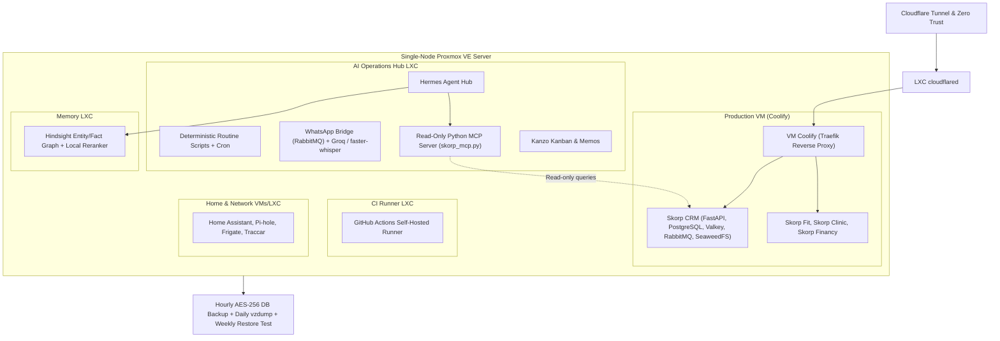

# Homelab & Central de IA

[Português](#versao-em-portugues) | [English](#english-version)

> **Aviso de código privado:** Este repositório é a vitrine pública de arquitetura do meu homelab pessoal e da Central de IA. Configurações, scripts internos e dados operacionais permanecem privados por segurança. Demonstração ao vivo sob pedido: [antonymsandrade@gmail.com](mailto:antonymsandrade@gmail.com) ou [LinkedIn](https://www.linkedin.com/in/antonyandrade01/).
>
> **Private repository notice:** This repository is the public architecture showcase for my self-hosted homelab and personal AI operations hub. Internal scripts, configs, and operational data remain private for security. Live demos are available on request: [antonymsandrade@gmail.com](mailto:antonymsandrade@gmail.com) or [LinkedIn](https://www.linkedin.com/in/antonyandrade01/).

---

## Arquitetura / Architecture

---

## Versão em Português

### Problema que resolve

Manter apps em produção beta, bancos PostgreSQL, storage S3, mensageria, runners de CI e rotinas de monitoramento em provedores comerciais cobra em dólar e encarece testes de infraestrutura. Operar tudo sozinho fora do expediente também pede backups confiáveis e alertas sem expor credenciais.

Este homelab reúne hospedagem de produção, CI/CD próprio, backups verificados e uma Central de IA em um único servidor Proxmox VE, sem abrir portas residenciais diretamente para a internet.

### Números reais

- Montado em 2025 e recriado do zero em junho de 2026, reunindo produção, CI/CD, backup testado e Central de IA.
- Roda em servidor Proxmox VE único com VMs e containers LXC separados para produção (Coolify), Central de IA, runner próprio do GitHub Actions, memória Hindsight, Cloudflare Tunnel, Home Assistant, Pi-hole, Frigate e Traccar.
- Mantém backup cifrado (AES-256) do banco do CRM de hora em hora com cópia no Google Drive, `vzdump` diário das VMs/LXC e teste automático semanal de restauração todo domingo validando integridade das tabelas e das mensagens.

### Decisões técnicas e trade-offs

#### Servidor Proxmox único atrás de Cloudflare Tunnel

O tráfego web entra pelo `cloudflared` e chega ao Traefik gerenciado pelo Coolify na VM de produção, evitando expor IP residencial e configurar proxy manualmente. O storage S3 roda em SeaweedFS (Apache-2.0) no lugar de soluções sob licença AGPL.

Trade-off: servidor único cria ponto único de falha de hardware, exige reinício programado diário de manutenção e gera cerca de 90 segundos de queda a cada deploy do CRM no Coolify. Em troca, o custo mensal de nuvem cai a quase zero e a recuperação fica coberta por backups externos testados toda semana.

#### Auditorias determinísticas sem IA para proteger segredos

Problema: em novembro de 2026 notei que uma rotina de auditoria controlada por agente com terminal podia mandar saída de comandos administrativos para um modelo externo de reserva.

O que foi feito: reescrevi as auditorias de infra, checagem de backup e vigia de cron como scripts determinísticos em Python sem chamada de LLM (`--no-agent`), lendo variáveis nos containers e emitindo apenas contagens numéricas. Também removi acesso a shell de bots conversacionais onde não era necessário.

Trade-off: scripts determinísticos não investigam falhas inéditas sozinhos, mas garantem que nenhuma senha ou variável de ambiente entre em contexto de modelo externo.

#### Servidor MCP de leitura em Python e integrações de terceiros

Para dar contexto operacional ao bot do time comercial sem liberar terminal, escrevi `skorp_mcp.py` em Python puro (JSON-RPC 2.0 sobre `stdio`), expondo ferramentas somente leitura com log de chamadas e testes de regressão contra prompt injection. Ferramentas como Kanzo, Hevy e Coolify conectam por seus próprios servidores MCP.

Trade-off: implementar o protocolo JSON-RPC à mão dispensa SDKs externos e deixa o controle de permissões explícito no código, ao custo de manter a camada de protocolo por conta própria.

#### Ponte de WhatsApp com transcrição híbrida e janela de disco

A ponte de WhatsApp consome fila dedicada no RabbitMQ e roteia mensagens quando o bot é citado ou mencionado (`@bot`). Os áudios vão primeiro para a API do Groq (~1 segundo) e caem para o `faster-whisper` local se a API externa falhar. A memória combina Hindsight (grafo de fatos e entidades com reranker local limitado pela CPU sem AVX2) e Memos. Como o container da central e os backups dividem um disco mecânico de 1 TB, tarefas pesadas respeitam janelas de I/O e o backup diário pausa o container por cerca de 2 minutos na madrugada.

### O que está no ar

- Servidor Proxmox VE com Coolify (Traefik), Cloudflare Tunnel, SeaweedFS S3, runner próprio do GitHub Actions e backups cifrados com teste semanal automatizado de restauração.
- Central de IA com rotinas determinísticas agendadas, ponte bidirecional de WhatsApp, servidor `skorp_mcp.py`, Hindsight, Memos e Kanzo.
- Automação residencial e rede local (Home Assistant, Pi-hole, Frigate, Traccar).

---

## English Version

### Problem it solves

Running beta SaaS apps, PostgreSQL databases, S3 storage, message brokers, CI runners, and monitoring on commercial cloud providers bills in USD and slows down infrastructure tests. Operating everything solo outside day-job hours also demands reliable backups and alerts without exposing credentials.

This homelab brings production hosting, self-hosted CI/CD, verified backups, and an AI operations hub together on a single Proxmox VE host, without opening residential ports directly to the internet.

### Real numbers

- First built in 2025 and rebuilt from scratch in June 2026 with production hosting, CI/CD, tested backups, and the AI hub.
- Runs on a single Proxmox VE host with dedicated VMs and LXC containers for production (Coolify), AI hub, GitHub Actions self-hosted runner, Hindsight memory, Cloudflare Tunnel, Home Assistant, Pi-hole, Frigate, and Traccar.
- Runs hourly AES-256 encrypted CRM database backups copied to Google Drive, daily `vzdump` snapshots, and an automated Sunday restore test verifying table and message integrity.

### Technical decisions and trade-offs

#### Single-node Proxmox host behind Cloudflare Tunnel

Web traffic enters through `cloudflared` and routes through Coolify's Traefik proxy on the production VM, avoiding exposed residential IPs and manual proxy configs. S3-compatible media storage runs on SeaweedFS (Apache-2.0) instead of AGPL alternatives.

Trade-off: a single host creates a hardware single point of failure, requires a scheduled daily reboot, and leaves CRM deployments with ~90 seconds of downtime in Coolify. In return, monthly cloud spend stays near zero and data recovery is verified weekly by automated restores.

#### Deterministic non-AI audits so secrets never reach an external model

Problem: in November 2026 I found that an AI-driven audit job with shell access could send administrative command output to an external fallback model.

What was done: operational audits, backup checks, and cron monitors were rewritten as deterministic Python scripts without LLM calls (`--no-agent`), reading container environment variables locally and emitting only numeric counts. Shell access was removed from conversational bots that did not need it.

Trade-off: deterministic scripts cannot improvise around novel failures on their own, but guarantee credentials never enter an external model context.

#### Hand-written read-only MCP server alongside third-party MCP tools

To give the product/team bot operational visibility without terminal access, I wrote `skorp_mcp.py` in pure Python (JSON-RPC 2.0 over `stdio`), exposing read-only tools with call telemetry and prompt-injection regression checks. Tools such as Kanzo, Hevy, and Coolify connect through their own MCP servers.

Trade-off: implementing JSON-RPC without an external SDK removes heavy dependencies and keeps permission checks explicit in code, at the cost of maintaining the protocol layer directly.

#### Hybrid audio transcription bridge and I/O-aware scheduling

The WhatsApp bridge consumes a dedicated RabbitMQ queue and routes messages by `@bot` mentions or quoted replies. Voice notes go to Groq first (~1 second) and fall back to local `faster-whisper` if the external API fails. Long-term memory combines Hindsight (entity/fact graph with a local reranker capped on the non-AVX2 CPU) and Memos. Because the AI hub LXC shares a 1 TB mechanical drive with backups, heavy jobs respect I/O windows and the nightly LXC backup pauses the container for about 2 minutes.

### What is live

- Single-node Proxmox VE running Coolify (Traefik), Cloudflare Tunnel, SeaweedFS S3, self-hosted GitHub Actions runner, and encrypted backups with automated weekly restore verification.
- Personal AI hub with scheduled deterministic scripts, bidirectional WhatsApp bridge, `skorp_mcp.py`, Hindsight, Memos, and Kanzo.
- Home automation and local network services (Home Assistant, Pi-hole, Frigate, Traccar).
