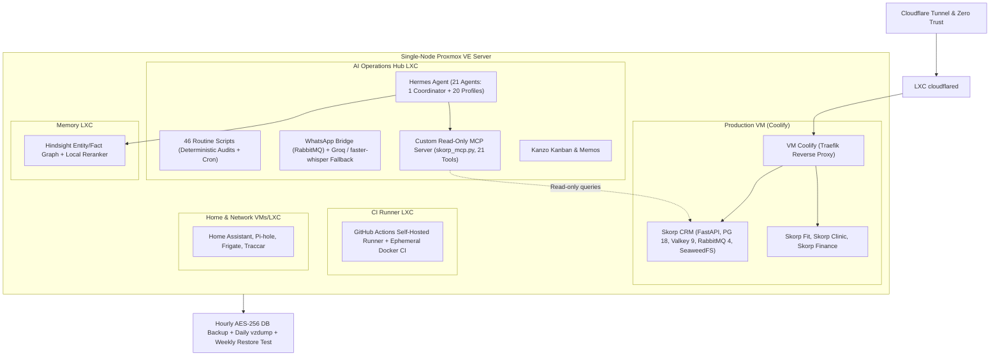

# Homelab & Central de IA

[Português](#versao-em-portugues) | [English](#english-version)

> **Aviso de código privado:** Este repositório é a vitrine pública de arquitetura do meu homelab pessoal e da Central de IA. Configurações, scripts internos e dados operacionais permanecem privados por segurança. Demonstração ao vivo sob pedido: [antonymsandrade@gmail.com](mailto:antonymsandrade@gmail.com) ou [LinkedIn](https://www.linkedin.com/in/antonyandrade01/).
>
> **Private repository notice:** This repository is the public architecture showcase for my self-hosted homelab and personal AI operations hub. Internal scripts, configs, and operational data remain private for security. Live demos are available on request: [antonymsandrade@gmail.com](mailto:antonymsandrade@gmail.com) or [LinkedIn](https://www.linkedin.com/in/antonyandrade01/).

---

## Arquitetura / Architecture

---

## Versão em Português

### Problema que resolve

Hospedar múltiplos produtos SaaS em beta, bancos PostgreSQL, storage S3, mensageria, runners de CI e rotinas de monitoramento em provedores de nuvem comercial custa caro em dólar e dificulta testes frequentes de infraestrutura. Ao mesmo tempo, operar tudo sozinho fora do expediente exige automação disciplinada de backups, alertas e triagem de incidentes sem expor credenciais.

Este homelab pessoal concentra produção, CI/CD, observabilidade básica e uma Central de IA multi-agente em um único servidor Proxmox VE bare-metal, sem abrir portas residenciais diretamente para a internet.

### Números reais

- Montado em 2025 e recriado do zero em junho de 2026, com produção, CI/CD, backup testado e Central de IA.
- Roda em um servidor Proxmox VE único (Xeon E3-1240 v2, sem AVX2) hospedando 9 VMs e containers LXC ativos: produção (Coolify), Central de IA, runner próprio do GitHub Actions, memória Hindsight, Cloudflare Tunnel, Home Assistant, Pi-hole, Frigate e Traccar.
- Opera 21 agentes na Central de IA (1 coordenador + 20 perfis especializados no Hermes Agent) e 46 scripts de rotina.
- Inclui servidor MCP escrito do zero em Python puro (`skorp_mcp.py`, JSON-RPC 2.0 sobre `stdio`, 21 ferramentas só leitura), validado por suíte de regressão de 17 casos e 250 chamadas registradas em produção em um único dia.
- Mantém backup cifrado em AES-256 do banco do CRM de hora em hora (RPO de 1 hora) com cópia no Google Drive, `vzdump` diário das VMs/LXC e teste automático de restauração todo domingo validando 57 tabelas, versão do Alembic e pelo menos 95% das mensagens.

### Decisões técnicas e trade-offs

#### Servidor Proxmox único com exposição só por Cloudflare Tunnel

Toda aplicação web entra pelo `cloudflared` (Cloudflare Tunnel) e chega ao Traefik gerenciado pelo Coolify na VM de produção, eliminando exposição direta de IP residencial e gerenciamento manual de proxy. O armazenamento de mídia S3 roda em SeaweedFS (Apache-2.0) no lugar de soluções sob licença AGPL.

Trade-off: servidor único significa ponto único de falha de hardware e reinício programado diário de manutenção, além de ~90 segundos de queda a cada deploy do CRM no Coolify (single Compose com nomes fixos de container). Em troca, o custo mensal de nuvem cai a quase zero e a recuperação fica coberta por backups externos cifrados e restauração testada semanalmente.

#### Auditorias determinísticas, sem IA, para nenhum segredo chegar a um modelo externo

Em novembro de 2026 percebi que uma rotina de auditoria rodada por agente de IA com terminal podia mandar saída de comandos administrativos para um modelo externo de reserva. A correção mudou a arquitetura: todas as rotinas de auditoria, sentinela de infra, checagem de backup e vigia de cron passaram a ser scripts determinísticos em Python sem IA (`--no-agent`), lendo variáveis diretamente dentro dos containers e emitindo apenas contagens numéricas. Bots conversacionais tiveram o terminal removido onde não era necessário.

Trade-off: scripts determinísticos são menos flexíveis para investigar sintomas inéditos sozinhos, mas garantem que nenhuma senha ou variável de ambiente entre em contexto de LLM externo.

#### Servidor MCP próprio só leitura e integração com MCPs de terceiros

Para dar contexto operacional seguro ao bot do time comercial/produto sem acesso a shell, escrevi `skorp_mcp.py` em Python puro (JSON-RPC 2.0 sobre `stdio`) expondo 21 ferramentas somente leitura com log de telemetria e suíte de regressão de 17 cenários (incluindo proteção contra prompt injection). Ferramentas de terceiros como Kanzo, Hevy e Coolify conectam via seus próprios servidores MCP.

Trade-off: manter um servidor MCP próprio em Python puro sem SDK exige manutenção manual do protocolo JSON-RPC, mas remove dependências pesadas e deixa o controle de permissões explícito linha por linha.

#### Ponte de WhatsApp com transcrição híbrida e gestão de memória/cotas

A ponte de WhatsApp consome fila dedicada no RabbitMQ e roteia mensagens por menção (`@bot`) ou citação. A transcrição de áudio usa Groq (`whisper-large-v3-turbo`) como caminho rápido principal (~1 segundo) e `faster-whisper` local como reserva quando a API externa falha. A memória de longo prazo combina Hindsight (extração de fatos e grafo de entidades com reranker local limitado a 40 candidatos pela CPU sem AVX2) e Memos. Como o LXC da Central e os backups dividem um disco mecânico de 1 TB, tarefas pesadas respeitam janelas de I/O e o backup diário congela o LXC por cerca de 2 minutos na madrugada.

### Em produção vs. em teste

Em produção (uso pessoal e hospedagem dos produtos):
- Servidor Proxmox VE com Coolify (Traefik), Cloudflare Tunnel, SeaweedFS S3, runner self-hosted do GitHub Actions e backups cifrados com teste semanal automatizado de restauração.
- Central de IA com 21 perfis de agentes, 46 scripts de rotina determinísticos e agendados, ponte bidirecional de WhatsApp, servidor `skorp_mcp.py`, Hindsight, Memos e Kanzo.
- Automação residencial e rede local (Home Assistant, Pi-hole, Frigate, Traccar).

Em teste / melhorias planejadas:
- Esteira automatizada de desenvolvimento noturno orientada por tags no quadro Kanban, com revisão separada por modelo e commit sem push automático.
- Separação do disco de backups do disco dos containers LXC para eliminar contenção de escrita.
- Migração do deploy do CRM para reduzir a janela atual de ~90 segundos de indisponibilidade.

---

## English Version

### Problem it solves

Running multiple beta SaaS apps, PostgreSQL databases, S3 media storage, message brokers, CI runners, and monitoring routines on commercial cloud providers gets expensive quickly in USD and slows down hands-on infrastructure work. Operating everything solo outside day-job hours also requires reliable backups, alerting, and incident triage without leaking secrets.

This personal homelab consolidates production hosting, self-hosted CI/CD, automated backup verification, and a multi-agent AI operations hub on a single bare-metal Proxmox VE server with no residential ports exposed directly to the internet.

### Real numbers

- First built in 2025 and rebuilt from scratch in June 2026 with production hosting, CI/CD, tested backups, and the AI hub.
- Runs on a single-node Proxmox VE server (Xeon E3-1240 v2, no AVX2) hosting 9 active VMs and LXC containers: Coolify production VM, AI hub, GitHub Actions self-hosted runner, Hindsight memory service, Cloudflare Tunnel, Home Assistant, Pi-hole, Frigate, and Traccar.
- Operates 21 Hermes Agent profiles (1 coordinator + 20 specialized bots) and 46 routine scripts.
- Includes a hand-written read-only Python MCP server (`skorp_mcp.py`, JSON-RPC 2.0 over `stdio`, 21 read-only tools) backed by a 17-case regression suite and 250 logged production tool calls in a single day.
- Runs hourly AES-256 encrypted CRM database backups (1-hour RPO) synced to Google Drive, daily Proxmox `vzdump` snapshots, and an automated Sunday restore test verifying 57 tables, Alembic head version, and at least 95% of messages.

### Technical decisions and trade-offs

#### Single-node Proxmox host behind Cloudflare Tunnel

All web traffic enters through `cloudflared` (Cloudflare Tunnel) and routes through Coolify's Traefik reverse proxy on the production VM, avoiding exposed residential IPs and manual proxy configs. S3-compatible media storage runs on SeaweedFS (Apache-2.0) instead of AGPL-licensed alternatives.

Trade-off: a single host creates a hardware single point of failure and requires a scheduled daily reboot, while CRM deployments on Coolify currently take ~90 seconds of downtime due to fixed container names in a single Compose stack. In return, monthly cloud spend stays near zero and data recovery is proven weekly by automated restores.

#### Deterministic non-AI audits so secrets never reach an external model

In November 2026 I found that an AI-driven audit job with shell access could send administrative command output to an external fallback model. The fix changed the architecture: operational audits, infrastructure sentinels, backup checks, and cron monitors were rewritten as deterministic Python scripts without LLM calls (`--no-agent`), reading environment variables inside target containers and emitting only numeric counts. Shell access was removed from conversational bots that did not need it.

Trade-off: deterministic scripts cannot improvise around novel failures on their own, but they guarantee credentials never enter an external LLM context.

#### Hand-written read-only MCP server alongside third-party MCP integrations

To give the product/team bot safe operational visibility without terminal access, I built `skorp_mcp.py` in pure Python (JSON-RPC 2.0 over `stdio`) exposing 21 read-only tools with call telemetry and a 17-case regression suite (including prompt-injection checks). External tools such as Kanzo, Hevy, and Coolify integrate via third-party MCP servers.

Trade-off: implementing JSON-RPC manually without a framework SDK requires explicit protocol handling, but keeps dependencies minimal and makes read-only enforcement easy to audit.

#### Hybrid audio transcription bridge and I/O-aware scheduling

The WhatsApp bridge consumes a dedicated RabbitMQ queue and routes messages by `@bot` mentions or quoted replies. Voice notes transcribe through Groq (`whisper-large-v3-turbo`, ~1 second) first, falling back to local `faster-whisper` if the external API fails. Long-term memory combines Hindsight (fact/entity graph with a local reranker capped at 40 candidates on the non-AVX2 CPU) and Memos. Because the AI hub LXC shares a 1 TB mechanical drive with backups, heavy jobs respect I/O windows and the nightly LXC backup pauses the container for roughly 2 minutes.

### Production vs. in testing

In production (personal infrastructure and product hosting):
- Single-node Proxmox VE running Coolify (Traefik), Cloudflare Tunnel, SeaweedFS S3, self-hosted GitHub Actions runner, and encrypted backups with automated weekly restore verification.
- Personal AI hub with 21 agent profiles, 46 scheduled and deterministic routine scripts, bidirectional WhatsApp bridge, `skorp_mcp.py`, Hindsight, Memos, and Kanzo.
- Home automation and local networking services (Home Assistant, Pi-hole, Frigate, Traccar).

In testing / planned improvements:
- Overnight automated coding workflow driven by Kanban tags, separate model review, and commit-without-push guardrails.
- Moving LXC container disks off the shared backup drive to remove write contention.
- Splitting the CRM deployment pipeline to reduce the current ~90-second deploy window.
